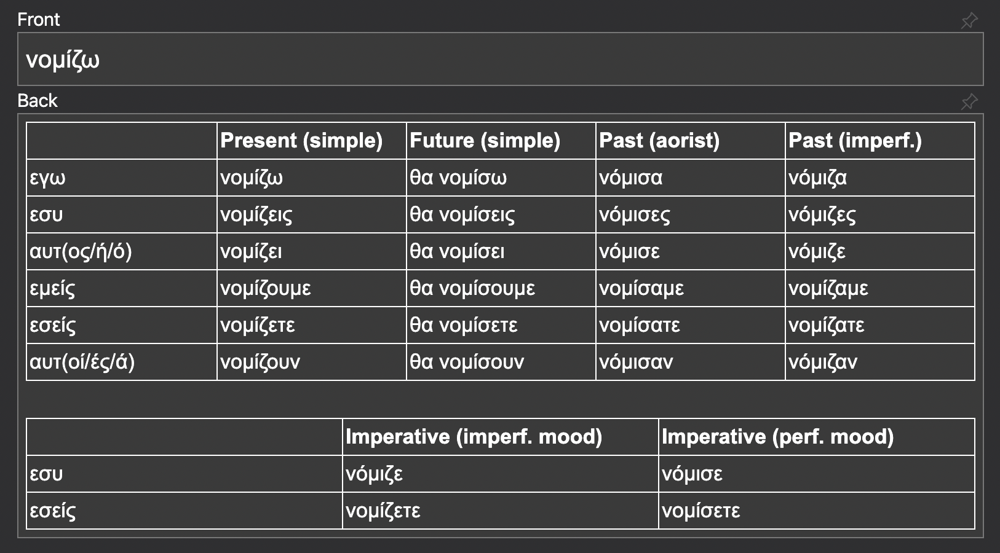

===========
greek-utils
===========

Programmable interface to Cooljugator's Modern Greek verb database.

Installation
---------------

Prerequisites

- Python 3.12+
- `uv <https://docs.astral.sh/uv/>`_
- `Anki Table add-on <https://ankiweb.net/shared/info/1237621971>`_ (so Anki can render the table within the card correctly)

.. code-block:: bash

    git clone git@github.com:tsouchlarakis/greek-utils.git
    cd greek-utils
    uv sync  # creates .venv from pyproject.toml + uv.lock
    .venv/bin/greek-utils --help

Usage
-----

**Scrape the Cooljugator website for all Modern Greek verb conjugations**:

.. code-block:: bash

    $ greek-utils scrape-conjugations --json-output-fpath ~/Desktop/verb_conjugations.json

**Show data for a given verb or verbs**:

.. code-block:: bash

    $ greek-utils show --verb νομίζω  # Can add an arbitrary number of verbs with --verb verb2 --verb verb3 ...

    +----------------+---------------+-------------+----------------+
    | Present Simple | Future Simple | Past Aorist | Past Imperfect |
    +================+===============+=============+================+
    | νομίζω         | θα νομίσω     | νόμισα      | νόμιζα         |
    +----------------+---------------+-------------+----------------+
    | νομίζεις       | θα νομίσεις   | νόμισες     | νόμιζες        |
    +----------------+---------------+-------------+----------------+
    | νομίζει        | θα νομίσει    | νόμισε      | νόμιζε         |
    +----------------+---------------+-------------+----------------+
    | νομίζουμε      | θα νομίσουμε  | νομίσαμε    | νομίζαμε       |
    +----------------+---------------+-------------+----------------+
    | νομίζετε       | θα νομίσετε   | νομίσατε    | νομίζατε       |
    +----------------+---------------+-------------+----------------+
    | νομίζουν       | θα νομίσουν   | νόμισαν     | νόμιζαν        |
    +----------------+---------------+-------------+----------------+

    +------------------------------+----------------------------+
    | Imperative Imperfective Mood | Perfective Imperative Mood |
    +==============================+============================+
    | νόμιζε                       | νόμισε                     |
    +------------------------------+----------------------------+
    | νομίζετε                     | νομίσετε                   |
    +------------------------------+----------------------------+

    Ελλήνικα: ... # first example usage in Greek
    English: ... # second example usage in Greek

    ...more example usages

**Print necessary information to create an Anki flashcard for a given verb**:

.. code-block:: bash

    $ greek-utils anki-flashcard --verb νομίζω
    νομίζω  <table class="table_class_basic_full_width" style="font-size: 85%; width: 100%; border-collapse: collapse; border: 1px solid;">
        <thead>
            <tr>
                <th style="width:20%; text-align:left; padding: 2px; border: 1px solid;">    </th>
                <th style="width:20%; text-align:left; padding: 2px; border: 1px solid;">Present (simple)</th>
                <th style="width:20%; text-align:left; padding: 2px; border: 1px solid;">Future (simple)</th>
                <th style="width:20%; text-align:left; padding: 2px; border: 1px solid;">Past (aorist)</th>
                <th style="width:20%; text-align:left; padding: 2px; border: 1px solid;">Past (imperf.)</th>
            </tr>
        </thead>
        <tbody>
            <tr>
                <td style="width: 20%; padding: 2px; border: 1px solid;">εγω</td>
                <td style="width: 20%; padding: 2px; border: 1px solid;">νομίζω</td>
                <td style="width: 20%; padding: 2px; border: 1px solid;">θα νομίσω</td>
                <td style="width: 20%; padding: 2px; border: 1px solid;">νόμισα</td>
                <td style="width: 20%; padding: 2px; border: 1px solid;">νόμιζα</td></tr><tr>
                <td style="width: 20%; padding: 2px; border: 1px solid;">εσυ</td>
                <td style="width: 20%; padding: 2px; border: 1px solid;">νομίζεις</td>
                <td style="width: 20%; padding: 2px; border: 1px solid;">θα νομίσεις</td>
                <td style="width: 20%; padding: 2px; border: 1px solid;">νόμισες</td>
                <td style="width: 20%; padding: 2px; border: 1px solid;">νόμιζες</td></tr><tr>
                <td style="width: 20%; padding: 2px; border: 1px solid;">αυτ(ος/ή/ό)</td>
                <td style="width: 20%; padding: 2px; border: 1px solid;">νομίζει</td>
                <td style="width: 20%; padding: 2px; border: 1px solid;">θα νομίσει</td>
                <td style="width: 20%; padding: 2px; border: 1px solid;">νόμισε</td>
                <td style="width: 20%; padding: 2px; border: 1px solid;">νόμιζε</td></tr><tr>
                <td style="width: 20%; padding: 2px; border: 1px solid;">εμείς</td>
                <td style="width: 20%; padding: 2px; border: 1px solid;">νομίζουμε</td>
                <td style="width: 20%; padding: 2px; border: 1px solid;">θα νομίσουμε</td>
                <td style="width: 20%; padding: 2px; border: 1px solid;">νομίσαμε</td>
                <td style="width: 20%; padding: 2px; border: 1px solid;">νομίζαμε</td></tr><tr>
                <td style="width: 20%; padding: 2px; border: 1px solid;">εσείς</td>
                <td style="width: 20%; padding: 2px; border: 1px solid;">νομίζετε</td>
                <td style="width: 20%; padding: 2px; border: 1px solid;">θα νομίσετε</td>
                <td style="width: 20%; padding: 2px; border: 1px solid;">νομίσατε</td>
                <td style="width: 20%; padding: 2px; border: 1px solid;">νομίζατε</td></tr><tr>
                <td style="width: 20%; padding: 2px; border: 1px solid;">αυτ(οί/ές/ά)</td>
                <td style="width: 20%; padding: 2px; border: 1px solid;">νομίζουν</td>
                <td style="width: 20%; padding: 2px; border: 1px solid;">θα νομίσουν</td>
                <td style="width: 20%; padding: 2px; border: 1px solid;">νόμισαν</td>
                <td style="width: 20%; padding: 2px; border: 1px solid;">νόμιζαν</td>
            </tr>
        </tbody>
    </table>
     
    <table class="table_class_basic_full_width" style="font-size: 85%; width: 100%; border-collapse: collapse; border: 1px solid;">
        <thead>
            <tr>
                <th style="width:33%; text-align:left; padding: 2px; border: 1px solid;">    </th>

                <th style="width:33%; text-align:left; padding: 2px; border: 1px solid;">Imperative (imperf. mood)</th>
                <th style="width:33%; text-align:left; padding: 2px; border: 1px solid;">Imperative (perf. mood)</th>
            </tr>
        </thead>
        <tbody>
            <tr>
                <td style="width: 33%; padding: 2px; border: 1px solid;">εσυ</td>
                <td style="width: 33%; padding: 2px; border: 1px solid;">νόμιζε</td>
                <td style="width: 33%; padding: 2px; border: 1px solid;">νόμισε</td>
            </tr>
            <tr>
                <td style="width: 33%; padding: 2px; border: 1px solid;">εσείς</td>
                <td style="width: 33%; padding: 2px; border: 1px solid;">νομίζετε</td>
                <td style="width: 33%; padding: 2px; border: 1px solid;">νομίσετε</td>
            </tr>
        </tbody>

        ...plus another HTML table with sample usages and their English translations

When pasted into Anki, it'll look like this:

**Note**: Install the `Anki Table add-on <https://ankiweb.net/shared/info/1237621971>`_ so Anki can render the table within the card correctly.

**Graded reading: build a daily text and check a read-aloud**:

The ``reader`` commands support a short daily loop for B2 learners: read an adapted news
text, then read it aloud. Personal inputs are passed at runtime and never stored here.

``reader build`` turns an article (URL, ``.html`` or ``.txt``) into JSON with target
words, the adaptation prompt, the checked text, per-word lemma and state, and glosses:

.. code-block:: bash

    $ greek-utils reader build https://example.org/article --vocab vocab.json \
        --frequent top-lemmas.txt --kaikki kaikki.org-dictionary-Greek.jsonl \
        --adapted adapted.txt --out today.json

- ``--vocab``: ``{"words": [{"lemma": "η σοδειά", "state": "due", "gloss": "harvest"}], "frequent": [...]}``.
  States are ``due``, ``recent``, ``lesson``, ``lapsed`` and ``known``; anything else in the text is new.
- ``--kaikki``: the Greek Wiktionary extract from `kaikki.org <https://kaikki.org/dictionary/Greek/>`_,
  used to map inflected forms to lemmas and for glosses. Glosses come from your own ``gloss`` first,
  then Wiktionary, then Glosbe (only for new and target words; ``--no-glosbe`` to stay offline).
- The adaptation is checked for length (130-170 words), new-word ratio (6-14% of content lemmas),
  target words used (at least 8), sentence length, and numbers, names and quotations that must
  match the source. Pass ``--adapted`` to check a text adapted elsewhere, or ``--adapter module:callable``
  to plug in a function that takes the prompt and returns the text (one retry with the failures,
  then an excerpt of the article). With neither, the excerpt is checked. ``--strict`` exits 1 on a failed check.

``reader compare`` aligns a transcript of the read-aloud against the text. The transcript is plain
text, or JSON with word timings and confidence (for example Whisper's ``word_timestamps`` output):

.. code-block:: bash

    $ greek-utils reader compare text.txt transcript.json --native-seconds 62
    138 of 142 words read cleanly
    121 words a minute (88% of native)
       14 πότε: stress, heard «ποτέ»
       37 αντιδήμαρχος: paused 2.1s
       58 εξαιτίας: skipped

Words come out clean, misread, stress (same letters, a different accented syllable), skipped,
or unclear (a low-confidence mismatch, or a number read as words; never an error), with
pauses of 1.5 s or more flagged. This is not pronunciation scoring: a recognizer usually
hears a near-miss as the intended word.

Changelog
---------

See `changelog <CHANGELOG.rst>`_.

License
-------

See `license <LICENSE>`_.
